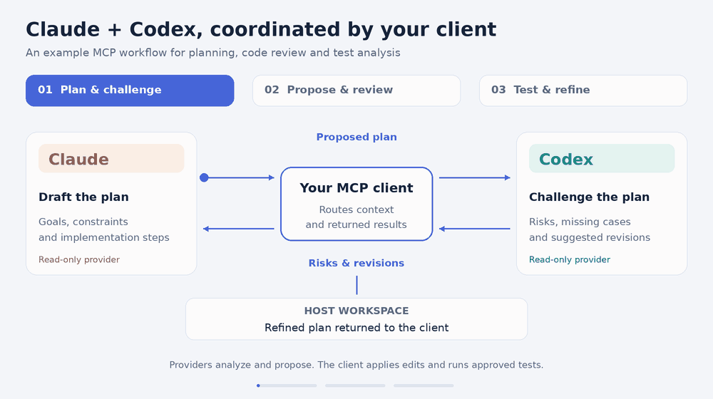

# AI-MCP-Containers



**Example collaborative workflow:** Your MCP client sends one agent's proposal to the
other for review and brings the results back. Providers analyze the read-only project;
the client applies approved edits and runs tests. Automatic orchestration is not built in.
[View the static overview](docs/assets/pair-workflow.png).

Two global Docker services use the host owner's local Codex/ChatGPT and Claude Code
subscriptions. Each service exposes `/chat` and `/v1/responses`; a local Node adapter
makes the service available to MCP clients over stdio.
No provider API key is required. The service's Bearer key is separate from provider
authentication; all callers share this installation's accounts and subscription quotas.

## Configure and start

Use a Linux host with Docker Compose, Node.js, rsync and compatible Linux provider
binaries from VS Code. Sign into the native Codex and Claude Code CLIs on the host.
Codex's updater supports Linux x64; Claude's launcher supports Linux x64 and arm64.
macOS and Windows extension executables cannot run in these Linux containers.

Copy `.env.example` to the ignored private `.env` and fill in these settings:

| Setting | Purpose |
| --- | --- |
| `AI_MCP_TOKEN` | Private service key, at least 32 characters. Generate with `openssl rand -hex 32`. |
| `AI_MCP_PROJECT_ROOT` | One existing absolute host directory for project and review access. |
| `AI_MCP_HOST_UID`, `AI_MCP_HOST_GID` | Host credential owner's IDs, from `id -u` and `id -g`. Use a non-root owner. |
| `AI_MCP_CODEX_EXT_BIN` | Dedicated stable Codex binary directory, normally `${HOME}/.codex-ext-bin`. |
| `AI_MCP_CLAUDE_EXTENSIONS` | Host VS Code extensions directory, normally `${HOME}/.vscode/extensions`. |
| `AI_MCP_MAX_CONCURRENT_REQUESTS` | Maximum active requests per provider; default `6`. |
| `AI_MCP_LAN_IP` | `auto` discovers the host's physical private IPv4 addresses at startup. Set one host IPv4 to restrict access, or leave empty to disable LAN access. |

Create the shared network once, prepare Codex's stable binary copy, then start:

```sh
docker network create ai-mcp-shared
./refresh-codex-bin.sh
./run-docker.sh --build
```

Skip network creation if `ai-mcp-shared` already exists. The startup wrapper validates
the resolved configuration before applying it. It preserves an existing ignored
`docker-compose.override.yml` and generates the LAN mappings from the selected host
addresses. The same resolved address list is checked and applied in that invocation.
Missing bind directories are never created automatically.

## Network access

| Client location | Codex | Claude |
| --- | --- | --- |
| This host | `http://127.0.0.1:8788` | `http://127.0.0.1:8789` |
| Docker container on `ai-mcp-shared` | `http://codex-mcp:8080` | `http://claude-mcp:8080` |
| LAN, for each selected host address | `http://<host-LAN-IP>:8788` | `http://<host-LAN-IP>:8789` |

Attach a client container to the external `ai-mcp-shared` network in its own Compose
configuration. LAN access supplements localhost access; existing local MCP clients
keep working. The preflight rejects wildcard/public bindings, Docker bridge addresses,
addresses not assigned to this host, and mappings that remove localhost access.

The example enables `AI_MCP_LAN_IP=auto`. On a Linux host using a local Docker Unix
socket, startup discovers RFC1918 IPv4 addresses on active physical network interfaces,
including Ethernet and Wi-Fi. Docker bridges, VPN/tunnel and other virtual interfaces
are excluded. Each discovered address receives its own port mappings; no wildcard
listener is added. TCP/SSH Docker endpoints and Docker Desktop are rejected in automatic
mode because local interface discovery cannot determine their daemon host's addresses.
Do not forward a remote daemon through a local Unix socket: automatic discovery assumes
the daemon runs on the same Linux machine as this checkout.
If no suitable address is found, only localhost and Docker-network access remain.

Automatic mode can expose the service on multiple connected private networks. To
choose one, set a single assigned private IPv4 instead; an empty value disables LAN
access. Addresses are discovered at startup, not continuously: run `./run-docker.sh`
again after a DHCP or network change to update the container port mappings.

Send `Authorization: Bearer <AI_MCP_TOKEN>` on every API request, including requests
from Docker peers and LAN clients. `/health` and the static UI are public. The UI
uses the service's default policy unless the user explicitly selects a supported
read-only mode. HTTP does not encrypt the key or traffic; use a TLS reverse proxy or
private tunnel across untrusted networks. A shared key does not identify individual users.

## Connect Claude and Codex as MCP clients

Both Codex and Claude Code can use **both** services: `ask_codex` calls the Codex
container and `ask_claude` calls the Claude container. The client and provider do not
need to be the same product. All calls use the Docker host owner's subscriptions.

The MCP client starts `node mcp/bridge-mcp.mjs` locally over **stdio**. The adapter then
calls the selected service's HTTP API. Do not register ports `8788` or `8789` as direct
MCP HTTP URLs; these services do not expose the MCP Streamable HTTP transport.

### Shared prerequisites

Start the containers first; registering an MCP server does not start Docker. On each
client machine, keep a checkout of this repository and install Node.js. Replace every
absolute-path placeholder below with a path on the **client's** machine:

| Placeholder | What to select |
| --- | --- |
| `/absolute/path/to/node` | Node executable, from `command -v node`. An absolute path also works when an IDE has a different `PATH`. |
| `/absolute/path/to/AI-MCP-Containers/mcp/bridge-mcp.mjs` | This checkout's adapter script, accessible to the MCP client. |
| `/absolute/path/to/private/ai-mcp.env` | Private file containing `AI_MCP_TOKEN=<service-key>`. On the Docker host, the repository's ignored `.env` can be used directly. |

Create or edit the private token file outside version control and restrict it with
`chmod 600 /absolute/path/to/private/ai-mcp.env`. Use the existing **service Bearer key**,
not a provider API key or OAuth token. A remote client needs only this key; do not copy
the host's Codex/Claude credential directories. The adapter reads the file itself;
do not `source` it. An exported `AI_MCP_TOKEN` takes precedence over the file.

The examples below run on the Docker host. For another LAN machine or a client
container, change `AI_MCP_URL` using the [network access table](#network-access).
`127.0.0.1` always means the machine/container where the adapter runs. A Docker client
must join `ai-mcp-shared` and use service port `8080`.

### Codex CLI and VS Code

Codex CLI and the Codex VS Code extension share `~/.codex/config.toml`. Add these
sections while preserving existing settings. The names `ai_mcp_codex` and
`ai_mcp_claude` are reserved for these **stdio** registrations: provider-side Codex
runs disable them to prevent recursive service calls. Do not use these IDs for HTTP
MCP registrations; conflicting transports fail configuration loading. Other custom
MCP entries are not disabled by this protection. See the [official OpenAI MCP documentation](https://developers.openai.com/codex/mcp).

```toml
[mcp_servers.ai_mcp_codex]
command = "/absolute/path/to/node"
args = ["/absolute/path/to/AI-MCP-Containers/mcp/bridge-mcp.mjs"]
startup_timeout_sec = 20
tool_timeout_sec = 1300

[mcp_servers.ai_mcp_codex.env]
AI_MCP_PROVIDER = "codex"
AI_MCP_URL = "http://127.0.0.1:8788"
AI_MCP_ENV_FILE = "/absolute/path/to/private/ai-mcp.env"
AI_MCP_TIMEOUT_MS = "1250000"

[mcp_servers.ai_mcp_claude]
command = "/absolute/path/to/node"
args = ["/absolute/path/to/AI-MCP-Containers/mcp/bridge-mcp.mjs"]
startup_timeout_sec = 20
tool_timeout_sec = 1300

[mcp_servers.ai_mcp_claude.env]
AI_MCP_PROVIDER = "claude"
AI_MCP_URL = "http://127.0.0.1:8789"
AI_MCP_ENV_FILE = "/absolute/path/to/private/ai-mcp.env"
AI_MCP_TIMEOUT_MS = "1250000"
```

Start a new Codex session after saving. Inspect the registrations with:

```sh
codex mcp list
codex mcp get ai_mcp_codex
codex mcp get ai_mcp_claude
```

In the interactive CLI, use `/mcp` to inspect active servers and tools. In VS Code,
reload the Codex session after editing the shared configuration.

### Claude Code CLI and VS Code

Install the Claude Code CLI if `claude` is not on your `PATH`; the VS Code extension
alone does not install a terminal command. User-scope registrations are shared by the
CLI and VS Code and apply across projects. Use a current CLI supporting JSON input
from stdin (version `2.1.327` or newer). See [Claude's JSON registration guide](https://code.claude.com/docs/en/mcp#add-mcp-servers-from-json-configuration)
and [VS Code MCP setup](https://code.claude.com/docs/en/vs-code#connect-to-external-tools-with-mcp).

Create a private directory with `mkdir -p ~/.config/ai-mcp-clients`. Save the following
as `~/.config/ai-mcp-clients/codex-service.json`, replacing the absolute paths:

```json
{
  "type": "stdio",
  "command": "/absolute/path/to/node",
  "args": ["/absolute/path/to/AI-MCP-Containers/mcp/bridge-mcp.mjs"],
  "timeout": 1300000,
  "env": {
    "AI_MCP_PROVIDER": "codex",
    "AI_MCP_URL": "http://127.0.0.1:8788",
    "AI_MCP_ENV_FILE": "/absolute/path/to/private/ai-mcp.env",
    "AI_MCP_TIMEOUT_MS": "1250000"
  }
}
```

Save the second registration as `~/.config/ai-mcp-clients/claude-service.json`:

```json
{
  "type": "stdio",
  "command": "/absolute/path/to/node",
  "args": ["/absolute/path/to/AI-MCP-Containers/mcp/bridge-mcp.mjs"],
  "timeout": 1300000,
  "env": {
    "AI_MCP_PROVIDER": "claude",
    "AI_MCP_URL": "http://127.0.0.1:8789",
    "AI_MCP_ENV_FILE": "/absolute/path/to/private/ai-mcp.env",
    "AI_MCP_TIMEOUT_MS": "1250000"
  }
}
```

Run these commands from a terminal **outside** a running Claude Code session:

```sh
claude mcp add-json ai_mcp_codex - --scope user < ~/.config/ai-mcp-clients/codex-service.json
claude mcp add-json ai_mcp_claude - --scope user < ~/.config/ai-mcp-clients/claude-service.json
claude mcp list
claude mcp get ai_mcp_codex
claude mcp get ai_mcp_claude
```

These commands update the user configuration in `~/.claude.json`; no key is placed in
the command arguments. Start a new CLI/VS Code conversation and open `/mcp` to inspect
the connections. Avoid project-scope `.mcp.json` files containing private tokens.

### Verify a request and coordinate the agents

Registration and tool discovery verify the local stdio connection, not the Bearer key
or provider quota. Please use this small README-review prompt when you would like to
check a real provider request before starting a larger task. It helps distinguish
connection, authentication and quota issues while returning a focused review. This
request consumes provider quota; reuse an existing successful check when its relevant
setup is unchanged. Ask the client to call `ask_codex` or `ask_claude` with input such as:

```json
{
  "prompt": "Review the project README and return three concrete improvements. Do not read secrets.",
  "cwd": "/absolute/path/to/mounted/project"
}
```

`cwd` must be an existing path under the Docker host's selected `AI_MCP_PROJECT_ROOT`,
using the path visible inside the service container. It is not a path on a remote
client machine. Omit `sandbox` to use the service default; see [adapter options](mcp/README.md)
for explicit read-only modes and their limitations.

Please use the following prompt when you would like both agents to contribute to
planning, implementation and verification. The complementary review helps surface
missing cases, and sharing existing test evidence keeps the work grounded without
repeating completed checks unnecessarily. Tell your client: **“Ask Claude for a plan, send
the complete plan to Codex for critique, and synthesize the revisions. Propose changes,
have the other agent review them, reuse valid passing test evidence, run only justified
affected tests locally, and send the evidence to both agents for analysis.”** Each
provider call is independent, so the client must pass the relevant prior output in the
next prompt. The containers return
analysis and proposals; the client's own tools apply edits and execute tests.

The examples allow a `1250000` ms adapter HTTP timeout and a larger outer tool timeout:
`1300` seconds in Codex, `1300000` milliseconds in Claude. This exceeds Claude's
1200-second provider deadline. Adjust these together; see [Claude's tool timeout reference](https://code.claude.com/docs/en/mcp#time-limits-on-mcp-tool-calls).

| Symptom | What to check |
| --- | --- |
| Node/script cannot start | Absolute executable and script paths on the client machine; IDE process permissions. |
| `401` | Correct service key and readable private ENV file; remove a stale exported `AI_MCP_TOKEN`. Restart the adapter after changing the file. |
| Connection refused | Containers are running and `AI_MCP_URL` matches the adapter's location. |
| `cwd_forbidden` / `403` | Use a project path inside the service's mounted root. |
| Outer tool timeout | Keep the client deadline longer than the adapter and provider deadlines. |
| `429` | Inspect the returned error: provider quota/rate limit or service concurrency limit. Re-registering MCP does not reset quotas. |

### Set up from a console prompt and keep the workflow

You can ask either coding client to configure both MCP connections and save the pair
workflow as a project instruction. Use the [ready-to-paste setup prompt](docs/console-setup.md)
and [shared collaboration rule template](docs/templates/ai-mcp-collaboration.md).
The recipe preserves existing settings, uses the private token file, and connects both
clients to one canonical project rule through `AGENTS.md` and `CLAUDE.md`.

For covered development tasks, the rule requires a complementary-provider plan review
and a final change/test-evidence review. Claude-led work iterates with Codex, and
Codex-led work with Claude, up to 20 review requests across the entire task. It prefers
the smallest sufficient durable change and evaluates architectural fit, security and
performance. It finishes early when ready and reports unresolved work rather than
claiming completion after quota failure, stalled review or exhausted budget.

For UI design or redesign, it requires three visual alternatives and explicit user
approval before implementation. Visible UI changes require AI inspection of rendered
views and evidence that affected interactions work, with simple UX and existing fonts
unless a change is requested. The adapter is text-only: an image-capable host performs
visual inspection while the peer reviews code and interaction evidence.

The rule is active in this repository through [AGENTS.md](AGENTS.md),
[CLAUDE.md](CLAUDE.md) and [one canonical policy](.ai-mcp/collaboration.md).
Agents are prohibited from independently changing, weakening or bypassing that policy
or its references. Amendments require an explicit user instruction. This is an agent
policy; technical immutability requires controls outside the agent's write authority.

MCP registration is user-scoped; the rule is project-scoped by default. The guide also
explains an explicit all-projects user rule. Start a new client session after setup.
The guide verifies rule loading, tool discovery and actual peer reviews separately.
These are persistent model instructions, not guaranteed orchestration or a permission
bypass; the client still owns edits/tests and reports unavailable reviews honestly.

## Security layers and limits

| Layer | What it enforces |
| --- | --- |
| Authentication | Startup refuses missing or short keys. API routes require a valid Bearer key by default, including case and trailing-slash variants. |
| Project mounts | Only the selected project tree is mounted for project access, read-only in both containers. The API rejects `workspace-write`. |
| Working directory | A request's `cwd` must exist under the allowed root. Symbolic-link components are resolved before containment checks. |
| Runtime | Read-only root filesystem, non-root application/provider processes, dropped capabilities, `no-new-privileges` and Docker's default seccomp profile. |
| Resource limits | Each provider has a global concurrency limit, 2 CPUs, 2 GiB memory and 256 PIDs. Different conversation IDs cannot bypass concurrency control. |
| Request state | The supplied Compose deployment does not resume or persist provider conversations. Clients supply context in each request. |
| Child environment | Service configuration and the Bearer key are removed from provider-process environments; the launcher retains its required extension path. |
| Model instructions | Every provider call receives fixed English instructions to avoid reading or exposing `.env`, private keys and credentials, including through Git history or alternate paths. This is behavioral guidance, not an enforced file-access restriction. |

The resource preflight rejects privileged/host-namespace overrides, extra capabilities,
unexpected bind sources and writable project mounts. It catches configuration mistakes;
it does not protect against a host administrator deliberately changing the deployment.

`AI_MCP_PROJECT_ROOT` grants access to the entire selected tree. A parent such as
`/mnt/projects` exposes other descendant projects and readable `.env` files. `cwd`
chooses a starting directory; it does not isolate files that are already mounted.
Choose a narrow root and keep real secrets outside it when confidentiality is required.
There is no AppArmor setup, filtered project copy or per-request directory scan.

Read-only mounts protect files from modification, not from being read. Native provider
credentials remain accessible to the provider runtime. Codex can use `danger-full-access`
internally when its native sandbox cannot run; Docker's read-only project mount remains
the project-write boundary. These containers are for trusted callers, not an execution
sandbox for untrusted prompts or mutually untrusted users. Model instructions and child
environment cleanup do not establish an operating-system secrecy boundary.

## Subscriptions and automatic updates

Codex shares the host `~/.codex` directory so atomic OAuth refreshes remain coordinated.
The service never prunes host-owned session files. Claude reads the host `~/.claude`
credential seed and uses a private writable runtime volume. Credential refresh and
runtime state require writes; project directories remain read-only. Provider quota
limits are returned as typed errors, including `429` and a retry time when available.

Claude selects the newest compatible stable extension on every invocation. Codex uses
a stable copy updated with rename-safe synchronization so active calls can finish.
The Codex binary copy and Claude extension source are mounted read-only in the containers.
Install the optional user updater and credential-directory recovery units with:

```sh
node scripts/install-user-services.mjs --install
```

The updater refuses unsafe destinations before synchronizing. See
[systemd/README.md](systemd/README.md), [CLAUDE-RUNTIME.md](CLAUDE-RUNTIME.md) and
[mcp/README.md](mcp/README.md) for provider, updater and client details.

## Migration and verification

Application names are `AiMcpContainers` and `AiMcp`; active environment names use
`AI_MCP_*`. Provider-native `CODEX_HOME`, `HOME` and `CLAUDE_CODE_TMPDIR` retain their
native meanings. The MCP adapter temporarily accepts deprecated client launcher aliases.

The canonical shared network is `ai-mcp-shared`. An existing installation can retain
`codex-shared` temporarily through an ignored local override while other projects
migrate their own client configuration. Do not remove a network with active consumers.

Reuse passing test evidence when sources and execution inputs are unchanged. Run new
and directly affected checks; image builds do not automatically rerun the test suite.
Completed passing checks must not be repeated merely because the task moves to another
stage or unrelated code/documentation changes. Report their existing evidence instead;
rerun a failed check only when a relevant fix or concrete finding justifies it. This is
a [mandatory project rule](.ai-mcp/collaboration.md#mandatory-test-evidence-reuse--owner-2026-11-19).
Tests of model instructions verify their attachment, not that a model can never ignore them.

Public `main` and `develop` use a clean root history. Older clones should be replaced
to avoid reintroducing removed commits. Rewriting branch history cannot erase other
people's clones, forks or GitHub caches. If a credential is published, revoke or rotate
it; rewriting history does not invalidate it. Never commit private `.env` files,
credential stores, private keys or machine-specific overrides.
